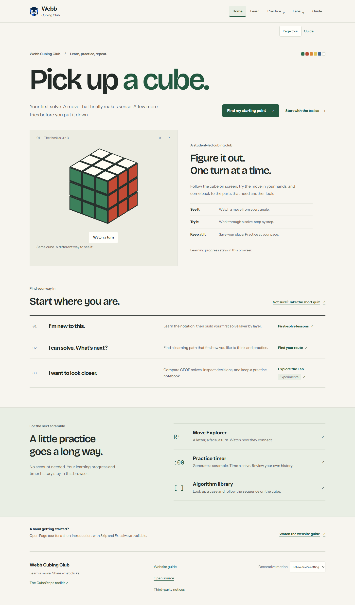
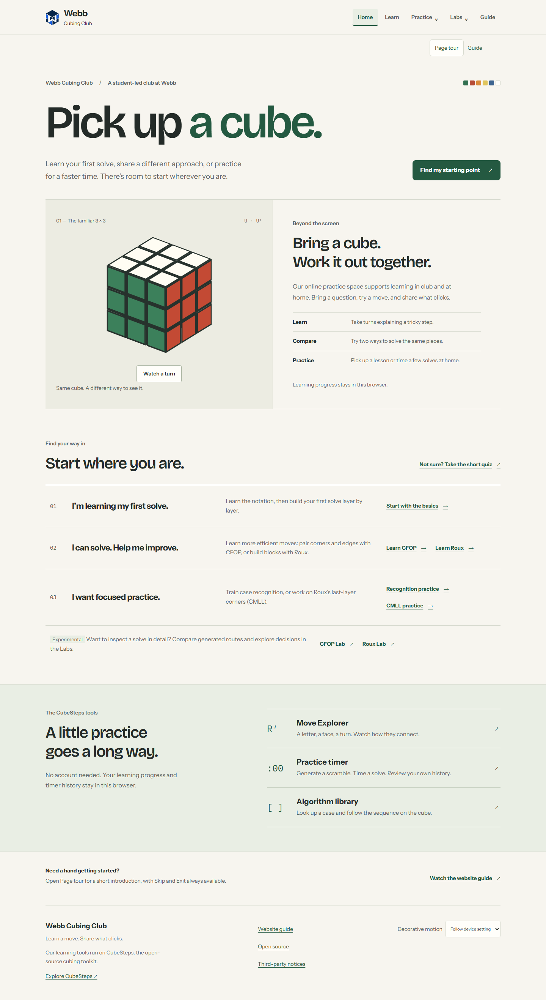
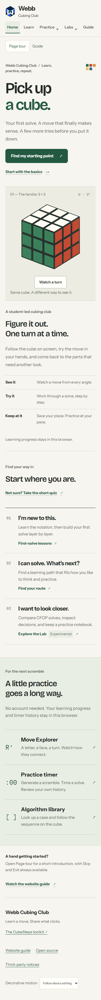
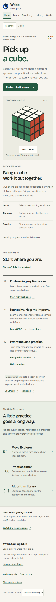

# Webb Cubing Club — Phase 2 refinement

## Scope and evidence

Baseline: `0e8bdf457f7044e7037b7eccad57ce64b06384a5`, fetched and fast-forward checked on October 31, 2026. The deployed homepage was opened and visually inspected. This phase retains the approved typography, paper/ink/green palette, logo, cube study and restrained motion.

Read before design: `docs/club-design-research.md`, `docs/club-redesign-report.md`, the original approved `docs/superpowers/specs/2026-10-12-webb-cubing-club-design.md`, and the current homepage, routes, learning wrapper, navigation and shared styles.

## Prioritized audit and decisions

| Priority / observed problem                                                                                    | Intended improvement and value                                                                                                                                                                                                                 | Regression risk / control                                                                                                                                                |
| -------------------------------------------------------------------------------------------------------------- | ---------------------------------------------------------------------------------------------------------------------------------------------------------------------------------------------------------------------------------------------- | ------------------------------------------------------------------------------------------------------------------------------------------------------------------------ |
| High: the club label is followed by three software benefits; the club and toolkit are easy to confuse.         | Introduce the student-led Webb identity immediately; replace the existing adjacent text with an invitation to learn, compare approaches and practice together. Explain that CubeSteps supplies the online tools. No extra promotional section. | Unsupported community claims: use the existing student-led label and original club/self-study purpose; invitations describe things students can do, not reported events. |
| High: developing solvers get another quiz while the curious pathway goes straight to an experimental CFOP Lab. | Offer direct beginner CFOP and beginner Roux lessons with plain explanations. Separate recognition/CMLL practice from experimental analysis.                                                                                                   | Misrouting/progression loss: reuse existing lesson URLs and progress hooks; test real destinations and resume after reload.                                              |
| Medium: practice pages also highlight Learn because ClubApp's final active-state branch defaults to learning.  | Make the Learn state specific to lessons, solve and questionnaire; practice/labs keep their existing grouped states.                                                                                                                           | Other routes losing state: cover library, case, practice and CMLL routes plus positive lesson state.                                                                     |
| Medium: hero and first row both lead to the same notation introduction.                                        | Retain the quiz/resume hero action; put the sole homepage basics action in the beginner row and move the existing tutorial target with it.                                                                                                     | Tour may point offscreen: retained guidance system scrolls to the actual first-solve action; run tutorial regression.                                                    |
| Medium: wording such as “A hand getting started?” and “I want to look closer” obscures the action.             | Use concise, specific language; keep successful headings such as “Pick up a cube.” and “Start where you are.”                                                                                                                                  | Avoid wholesale copy churn; preserve functional labels in tools unless inaccurate.                                                                                       |
| Visual: adding choices can make the ruled rows crowded.                                                        | Keep the existing three-row rhythm, use wrap-capable action groups and readable measures rather than more cards.                                                                                                                               | Inspect five widths and zoom, keyboard focus, touch areas and overflow.                                                                                                  |

Visual inspection also caught a shared interaction defect: in WebKit, clicking a dropdown did not focus its button, so Escape could leave the menu open. A unit regression and real WebKit assertion both reproduced it before the fix. The trigger now explicitly receives focus on activation, so the existing contained Escape/Tab handling works consistently; no global key listener was added.

## Content provenance and limits

- The existing homepage explicitly describes a student-led cubing club. The original approved club design's purpose is live club teaching and self-study at home; its architecture distinguishes the Club edition from the public CubeSteps toolkit. These are the basis for the revised identity.
- Do **not** publish the original document's approximate audience estimate as a current membership count. There is no verified current schedule, room, contact address, event record, testimony, member photography or school endorsement in this audit.
- Optional future content proposal (not rendered): a single “Meet the club” line with an owner-confirmed meeting day/location and a consented contact route. Require current confirmation and an owner/date for maintenance. Add a real activity photograph only with permission and accurate caption. No empty placeholder cards are shipped.

## Research use

No second broad inspiration sweep is needed. The prior directly observed MIT Solar Electric Vehicle Team About and Hack Club examples informed a narrow principle: explain the people/purpose before listing software features. The existing WCA FAQ and Mathigon observations support plain entry choices and learning before advanced tooling. This phase does not claim to have revisited those sites or borrow their appearance; all reference URLs and observation limits remain in `docs/club-design-research.md`. The unresolved question is missing Webb-specific content, which outside inspiration cannot verify.

## Validation and comparison

### What changed

- Homepage: student-led Webb identity in the masthead; the existing cube spread now invites students to explain steps, compare approaches and practice. Shorter text after tablet inspection keeps the two columns balanced.
- Three semantic, ruled learning rows: one first-solve action; direct CFOP/Roux teaching choices; recognition/CMLL practice. The Labs sit below these rows in a separate Experimental note. Rows are content, with visibly underlined actions rather than an ambiguous whole-row click target containing multiple choices.
- The `home.learn` tour target moved with the first-solve link. Quiz and saved-lesson resume behavior are retained.
- Shared navigation only marks Learn current on lessons, solve and questionnaire pages. Algorithm/CMLL practice pages use their existing Practice state.
- A click-opened shared navigation dropdown keeps its keyboard controls available in WebKit. Escape closes it and returns focus to its trigger.
- Shared footer explains that CubeSteps is the open-source toolkit behind the club's learning tools. Timer empty states now say what data is missing and how to populate it; the timing reminder describes checking the scramble.
- Typography families, tokens, route parsing, storage schemas, solver code, cube controls and motion code are unchanged. Layout edits are limited to the existing cube spread, wrap-capable pathway actions, the Labs note and footer paragraph measure. No dependencies added.

| Files                                                                                                  | Responsibility                                                       |
| ------------------------------------------------------------------------------------------------------ | -------------------------------------------------------------------- |
| `src/club/HomePage.tsx`, `src/club/home.css`                                                           | Club identity, learning choices, tutorial target and responsive rows |
| `src/club/ClubApp.tsx`, `src/club/components/ClubHeader.tsx`                                           | Specific Learn active state                                          |
| `src/ui/SectionMenu.tsx`, `src/ui/SectionMenu.test.tsx`                                                | Pointer activation retains shared dropdown keyboard behavior         |
| `src/club/components/ClubFooter.tsx`, `src/club/shell.css`                                             | Toolkit relationship and paragraph measure                           |
| `src/club/timer/TimerHistory.tsx`, `TimerTrend.tsx`, `TimerSurface.tsx`                                | Empty-state and scramble-check wording                               |
| `e2e/club-phase2.spec.ts`, `e2e/club-editorial.spec.ts`                                                | Pathway, persistence, touch, focus, reflow and five-width coverage   |
| This report, `docs/assets/club-phase2/`, `docs/superpowers/plans/2026-10-31-club-phase2-refinement.md` | Decisions, comparison images and execution plan                      |

### Visual review

Baseline and revised captures cover the homepage at **320, 375, 768, 1024 and 1440px**, plus CFOP/Roux lessons, Timer, Moves, algorithm library and both Labs at 375/1440px. Captures are in `validation/club-phase2-refinement/{before,after}` outside Git; selected comparisons are included below. The initial capture harness was corrected to wait for the welcome prompt, section animations, timer readiness and asynchronous cube rendering; loading-frame captures are not used as evidence of finished rendering.

The baseline's successful font hierarchy, headline, cube illustration, ruled rows and tool directory remain. The revised desktop removes one duplicate hero action; the first-solve link is in its learning row. On phones, separate lesson actions wrap with at least 44px touch areas. On tablets, the community text was shortened after seeing an unnecessarily tall right column. The footer can wrap naturally without squeezing its explanatory paragraph.

The following full-page captures use the same viewport widths and fresh local progress. Open an image for its original resolution.

| Desktop — before                                                        | Desktop — after                                                       |
| ----------------------------------------------------------------------- | --------------------------------------------------------------------- |
|  |  |

| Phone — before                                                        | Phone — after                                                       |
| --------------------------------------------------------------------- | ------------------------------------------------------------------- |
|  |  |

### Verification record

- Three new behavioral cases first failed against baseline: absent direct CFOP/practice choices and the incorrect Learn highlight. Then **20/20** focused Chromium/WebKit entry, pathway, persistence and reveal cases passed.
- **48/48** final Chromium/WebKit browser cases passed: eight learning/practice surfaces across five widths, homepage cube controls, tutorial keyboard/exit handling, touch navigation, Roux streaming-focus/comparison behavior, and CSS 200% zoom/reflow. The latter now also checks click-then-Escape closure and focus restoration after the screenshot exposed that gap; its narrower zoom scope is stated below.
- Final `npm run test:unit`: **238 files / 1108 tests passed**, followed by **3/3** crop-geometry regressions. Existing jsdom `scrollBy` not-implemented notices remain in the log; they did not fail tests.
- Typecheck, changed-file Prettier check and `git diff --check` passed. Production build passed. The existing large cubing/WASM chunk advisory remains; this phase adds no dependency or chunk-budget exception.
- Both built video files retain the accepted byte sizes and SHA-256 hashes; `media-verification.json` preserves the comparison. No video was re-encoded.
- The complete final production suite passed **84/84** Chromium/WebKit cases in 15 minutes. This includes actual worker/renderer state, all 54 Move Explorer moves, lesson and timer persistence/export, video playback/seek/fallback, Roux streaming focus/comparison/notebooks, deep links and both editions' responsive workspaces. No retry, timeout increase or assertion removal was used.
- The first production run was intentionally interrupted after its 42 Chromium checks passed, so the screenshot-discovered dropdown fix could be included in a fresh final build. Its partial log is retained and is not counted as a complete suite.
- The independent `npm test` attempt is **not reported as passing**. Its 8,000-route Advanced Roux corpus launches a literal worktree-local `node_modules/vitest/vitest.mjs`; dependencies here resolve from the primary checkout, so its children failed with `MODULE_NOT_FOUND` before replay. The broad run was stopped and its log retained. The dedicated unit command above passed; solver corpus re-proof is not part of this UI-only refinement. No test gate was edited or bypassed.

Full output is retained in `validation/club-phase2-refinement/` outside the checkout: `unit-final.log`, `browser-final.log`, `production-final.log`, `build-final.log`, red regressions and screenshot observations. A fresh, read-only whole-branch review of `0e8bdf4..4bff617` found no Critical, Important or actionable Minor issues. Its verdict was ready to merge within the documented verification limits; publication remains outside this phase. The complete review and scope rulings are preserved with the external evidence.

### Explicit limits

Publication follow-up: the owner subsequently authorized PR #23, merge after checks, deployment and local synchronization on October 31. The first PR CI passed 360 of 362 development browser cases; both failures were the same storage test selecting “CFOP Lab” globally after opening the navigation menu. The new homepage Experimental link made that locator ambiguous. This reproduced in both browsers. The test now scopes Home, Labs and CFOP Lab to Main navigation and checks the destination URL, retaining every storage assertion and timeout. All **24/24** focused development storage, entry and Phase 2 cases then passed, including the transaction fixtures. No product code or CI gate changed. Logs and traces are preserved with the publication evidence; final deployment still depends on the replacement commit's full CI and live verification.

- Native Edge **200% browser zoom remains unverified**. The Windows computer-use tool stopped because it could not reliably establish the current browser URL. No further native UI control was attempted. Automated CSS zoom/reflow checks are a separate, narrower check and must not be called real browser zoom acceptance.
- Screenshots are viewport evidence, not a claim that every lesson, screen-reader combination or physical touch device has been manually reviewed. No formal WCAG certification is claimed.
- The approved films and their editable sources are unchanged; this small homepage copy/pathway refinement is not reflected in their recorded frames. No new video production was requested.
- The original Phase 2 brief ended at local review. Publication was separately authorized afterward; the publication receipt, rather than this implementation report, records the final deployment state.
