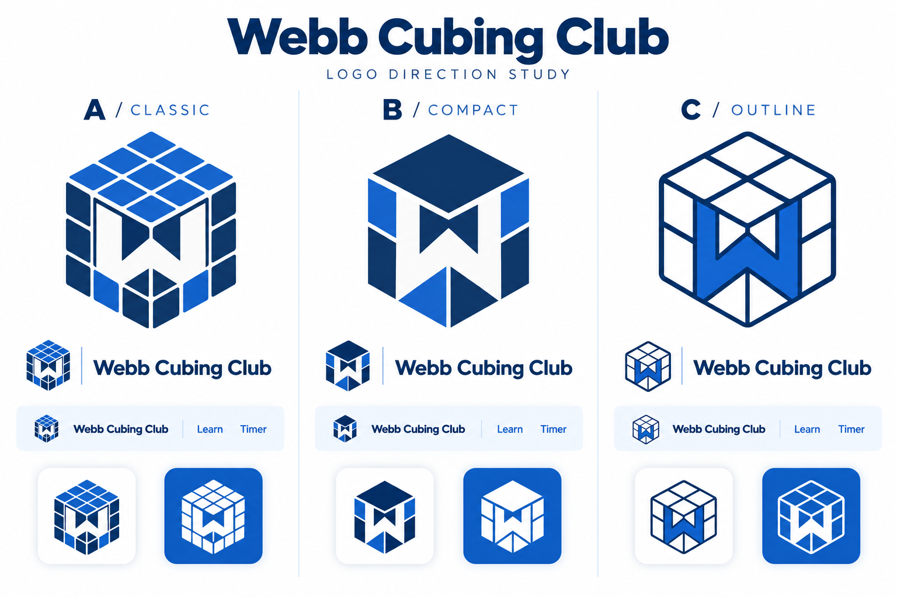
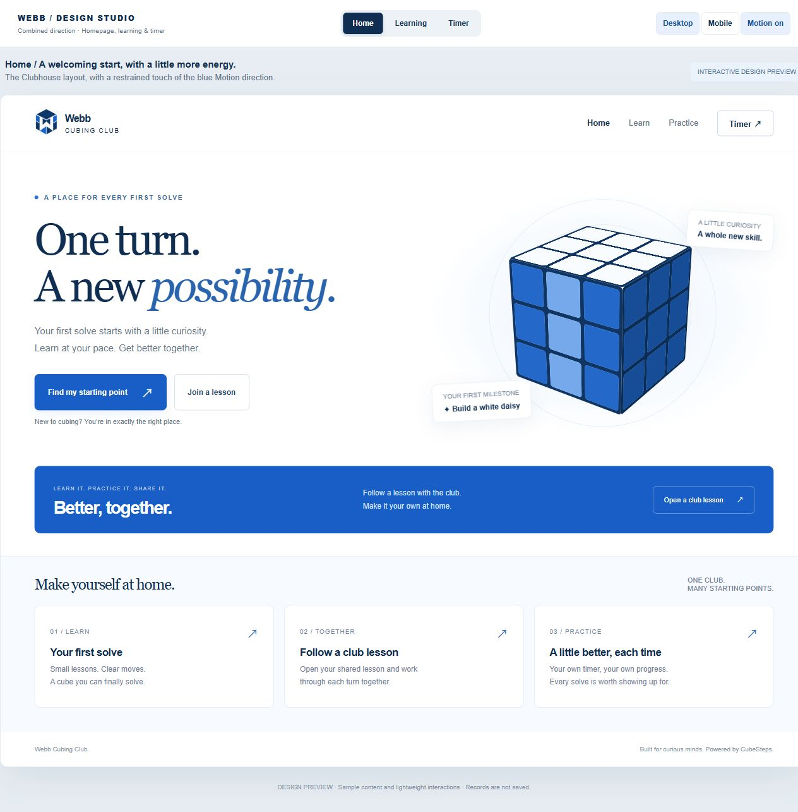
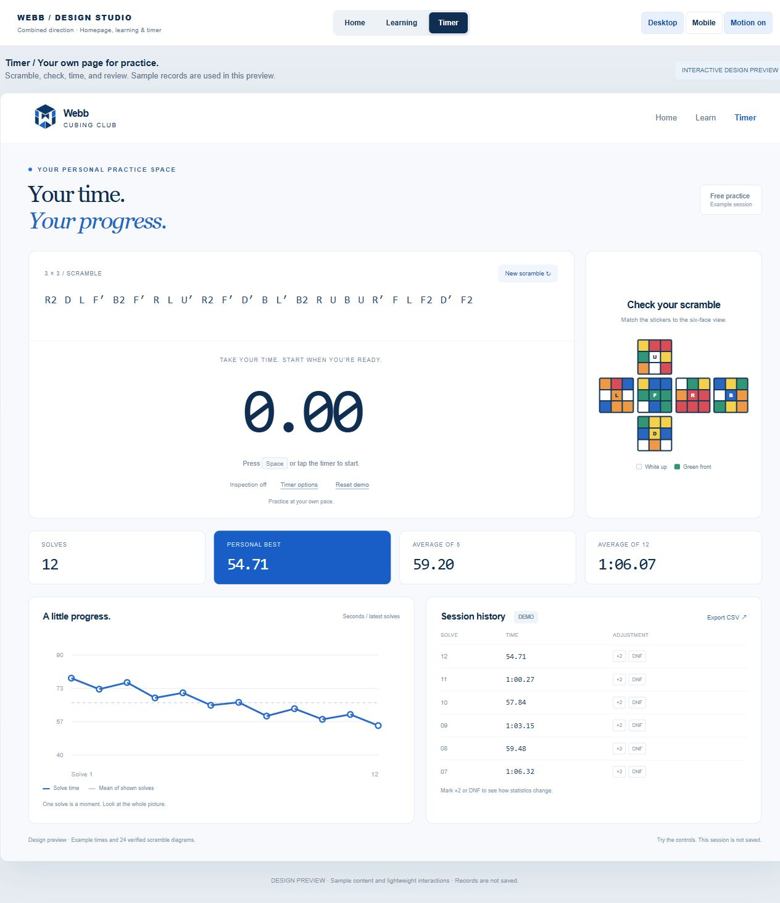
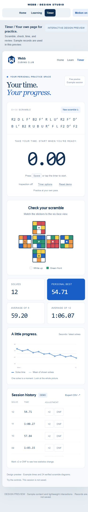

# Webb Cubing Club: Public Club Edition

Status: written design approved by the owner on October 12, 2026. Implementation is split into foundation/learning and timer plans for review, following the shared F2L improvement. The browser preview is a disposable design prototype.

## 1. Purpose and audience

Create a refined, approachable club website for roughly 40 Webb Cubing Club members. Most cannot yet solve a cube independently; a smaller group can already solve. Support both live club teaching and self-study at home. Keep the product entirely in English.

The club site is public and opens from an ordinary link or QR code. No GitHub account, membership login, payment or backend is required. Global CubeSteps remains a public, open-source product for everyone. Blue and white are the school colors supplied by the owner; the proposed palette is a club web treatment, not a claim of official school brand specifications.

Success means a new member can find a suitable starting lesson, follow it with a physical cube, resume learning later, and use a separate timer with trustworthy scramble diagrams and statistics.

## 2. Confirmed visual direction

- Homepage: the approved A/Clubhouse direction, with generous white space, friendly editorial headings, and a small amount of C/Motion's stronger blue and animated emphasis.
- Learning: the approved B/Focus direction, making the current lesson, current instruction and next action easy to find.
- Logo: refine the selected compact B concept, preserving a W integrated into a cube. Deliver a clean, scalable mark, horizontal wordmark, small icon and one-color treatment. The exploration raster is a direction reference, not the final production asset.
- Palette: deep navy text, royal-blue accents, white and pale-blue surfaces. Functional contrast and clear focus states take priority over matching an unverified school hex code.
- Keep real cube sticker colors in teaching and scramble diagrams. Blue/white decoration must not replace the six puzzle colors.

Approved layout references:

The references establish composition, density, chart sizing and visual character. Sample times, sample text, decorative cubes and incomplete prototype behaviors are not production data. The approved learning direction uses a focused cube/instruction layout and a clear lesson list; it reuses the actual existing lesson content.

## 3. Architecture and public entry points

Use the existing repository and React/TypeScript/Vite stack, with two page entry points in one deployable Pages artifact:

- Global: `/cube-steps/`, preserving existing hash routes.
- Club: `/cube-steps/club/`, with its own title, logo, navigation, visual tokens and hash routes.

The club URL is a planned address until deployed and verified. Keep the current GitHub Pages host. No new repository, paid host, custom domain purchase or access-control service is required.

A club application shell composes shared cube state, methods, course content, algorithm registry, color input, player and scramble services. Share focused content/controllers where the current pages include global layout assumptions; do not fork formula data or copy solver implementations. The timer domain and questionnaire rules are independent of the app shell and independently testable.

Alternatives considered: a separate fork makes initial branding easy but duplicates solver fixes; replacing the global interface would lose the distinct club experience. Two entry points with a shared core preserve both identities and one correctness authority.

Proposed boundaries:

| Unit | Responsibility and dependencies |
| --- | --- |
| Club shell and routes | Branding, page navigation and club layout; composes shared features |
| Learning recommendation | Pure answer-to-route rules; reads the supported-method registry |
| Learning progress | Local resume state and self-reported lesson progress; no mastery scoring |
| Shared teaching UI | Course, solver, color input, algorithms and player; same trace/registry as global |
| Timer domain | Input state machine, elapsed time and result/statistic rules; independent of rendering |
| Timer persistence | Validated records and settings; supplies history and export |
| Timer views | Timing surface, scramble/net, result history and trend graph |
| Motion primitives | Focus/transition feedback used by both editions; respect reduced motion |

Lazy-load heavy cube/search features where possible. Reuse the existing worker-safe cubing.js integration. Verify both entry points and asset paths under the Pages base path, including direct links and browser reloads.

## 4. Navigation and learning

The primary club navigation is Home, Learn and Timer. Solve Your Cube, Algorithms and Practice remain clearly accessible from learning/practice areas without crowding the homepage. Club feature links stay in the club shell. Include a modest link to global CubeSteps and its open-source repository.

| Page | Club hash route | Main action |
| --- | --- | --- |
| Home | `#/` | Start learning or resume the saved lesson |
| Route questionnaire | `#/find-your-route` | Get an explained starting recommendation |
| Learning | Existing `#/learn/...` patterns | Watch, follow, check and continue |
| Free solving | Existing `#/solve/...` patterns | Enter a scramble or six faces and choose a supported method |
| Library / practice | Existing `#/algorithms/...` and `#/practice` | Review formulas and practice selected cases |
| Timer | `#/timer` | Scramble, verify, time and review results |

The homepage emphasizes a first lesson for new members, a resume action for returning members and a short club learning section. Do not invent meeting times, member profiles, announcements or school endorsements. Club teaching can share an ordinary lesson URL; no live classroom synchronization is added.

Learning retains LBL's white-daisy route, Beginner CFOP and Advanced CFOP. Give each lesson an aim, holding instruction, focused player/explanation, result check and next lesson. Keep stage navigation available but visually secondary on phones. Members may mark a lesson practiced; labels must make clear that this is self-reported, not proof of a physical solve. Save the last visited lesson and practiced lesson IDs. Allow route changes and repeating any lesson without locking progression.

Preserve existing method Preview labels until their teaching acceptance is complete. The separate [F2L design](2026-10-12-f2l-human-friendly-design.md) defines the shared follow-along improvement.

## 5. Learning questionnaire

Use four brief questions, with a skip option leading to the course chooser:

1. Current ability: not yet independent; can solve with a beginner method; comfortable pairing F2L but still learning last-layer basics; comfortable with F2L and two-look OLL/PLL.
2. Goal: first independent solve; smoother understanding and execution; learning more advanced formulas and reducing steps.
3. Typical practice time: short sessions or longer sessions.
4. Usual setting: club meetings, home practice or both.

The questionnaire only recommends available LBL, Beginner CFOP and Advanced CFOP. It does not diagnose aptitude, require a time benchmark, or promote unavailable Roux/ZZ courses.

Deterministic rules:

- Not yet independent: LBL, starting at notation/holding and the white daisy.
- Can solve with a beginner method: Beginner CFOP, starting at its introduction and direct-bottom cross.
- F2L is comfortable but last-layer basics are still developing: Beginner CFOP, with an explanation that two-look last-layer skills provide the next foundation.
- F2L and two-look last layer are comfortable, and the goal is advanced formulas: Advanced CFOP, starting at its introduction and choosing a small OLL/PLL study group next.
- Otherwise: Beginner CFOP as a consolidation route, with an explicit option to choose Advanced CFOP instead.

Practice time changes suggested session size, and setting changes the suggested way to practice; neither changes claimed ability. Each result shows the recommended route, reasons grounded in the answers, a manageable next step, the first lesson link, and a visible Change Route action. Store only the chosen route and needed resume state locally; do not collect names, email, school rosters or questionnaire analytics.

## 6. Standalone timer

### Layout and scramble reference

Keep the approved full-page composition: prominent time and start guidance, a readable scramble, and supporting diagram/statistics/history. On phones, stack the sections and retain a comfortably sized six-face net. During timing, suppress decorative motion and visually reduce secondary content.

Generate fresh 3x3 scrambles through the existing cubing.js scramble service. Derive each net by applying that exact displayed scramble to the solved state using the shared engine. Use the documented white-up, green-front hold, face labels and the existing facelet layout. Never select production scrambles from the prototype's 24-example list.

Treat the scramble text, resulting state and net as one versioned unit. Disable starting until it is ready. A generation error offers Retry; stale responses cannot replace a newer scramble. Freeze the attempt's scramble at inspection/start. Queue the next scramble after stopping and consuming the stop key/pointer release; preserve the completed attempt's original scramble in its history record.

### Controls and timing

Use a monotonic clock to measure elapsed time. Animation frames only update the display; they do not count time. Display hundredths of a second and store unrounded elapsed milliseconds. Timer controls work without a mouse and on touch screens.

- Without inspection: hold Space or the timing surface for 300 ms to arm, then release to start. Releasing early returns to idle.
- With inspection: the first press/release begins inspection. A subsequent hold/release arms and starts the solve. Inspection continues during the arming hold.
- While running: Space key-down or pointer-down on the timing surface stops once. Ignore repeated key events and synthetic duplicate click events. The matching release cannot begin another attempt.
- Inputs, links, buttons and open dialogs do not trigger global Space timing. Escape cancels inspection/arming without a record. Escape during a running solve stops and records a DNF, with its raw elapsed time retained.
- Changing routes, losing window focus or hiding the document cancels an unstarted attempt. A running attempt interrupted this way is recorded as DNF with an interruption reason; it is never saved as an ordinary successful time.

Inspection is optional and off by default. When enabled, show elapsed/remaining inspection and clear penalty state: below 15 seconds has no inspection penalty; from 15 seconds up to but not including 17 seconds adds two seconds; 17 seconds or more marks DNF. Preserve the penalty at actual solve start, not at the earlier arming press. These boundaries follow [WCA A4d1/A4d2](https://www.worldcubeassociation.org/regulations/#A4d1); this browser tool is for personal practice and is not an official competition timer.

### Results, averages and graph

Start with one local practice history, with no session-management subsystem. Each attempt stores an ID, creation time, raw duration, scramble, inspection duration/penalty, manual penalty, interruption reason when applicable, and schema version. Use raw duration for auditability; derive the effective result. The manual control selects normal, +2 or DNF. Inspection and manual time penalties add; DNF overrides a numeric result.

Show attempt count, best valid single, current ao5 and current ao12. For ao5, use the latest five attempts, remove one fastest and one slowest, and average the remaining three; two DNFs produce DNF. This matches [WCA 9f8/9f9](https://www.worldcubeassociation.org/regulations/#9f8). For this app's ao12 practice statistic, use the latest twelve, remove one fastest and one slowest, and average the remaining ten; two DNFs produce DNF. Ao12 is not presented as an official WCA competition format. If too few attempts exist, show an explanatory empty value. Averages use stored times plus penalties and round only the final display.

The trend chart shows the latest 50 attempts, effective solve times and available rolling ao5/ao12, with a simple visible series selector. DNF is marked as DNF, never plotted as zero or an arbitrarily huge time. Label the time axis, attempt axis and displayed range. Provide values through keyboard-accessible details and the history list; color is not the only means of distinguishing series.

History is paginated, newest first. Members can inspect a saved scramble/net, change a penalty, and delete an accidental attempt with Undo. Recompute affected averages and the chart. Export all local history as CSV and versioned JSON, including raw times, penalties and scrambles. Import, cross-device synchronization, rankings, accounts, hardware timers and online competitions are deferred.

## 7. Local data and errors

Use namespaced, versioned local storage for club preferences and learning progress, separate from existing global practice selections. Use IndexedDB records/transactions for timer history so history is not rewritten as one growing settings blob. Preserve existing CubeSteps keys and behavior.

Save an attempt at most once, even if a stop event repeats. Retain it in memory until persistence succeeds. If storage is unavailable, full or fails, show a concise Not saved message, keep timing usable for the current page, offer retry and export, and never claim the record was saved. Malformed or newer unsupported data must not be silently overwritten. Known schema migrations preserve valid records. Refresh never resumes a running timer or invents a completed solve.

Per-record transactions and a cross-tab notification channel avoid overwriting another tab's history with a stale whole-history snapshot. Reload affected records when notified; the database remains authoritative. The two editions share an origin but use distinct preference keys. Explain near history/export that records live in this browser and can be lost if browser data is cleared.

Provide useful loading, empty, retry and unknown-route states. Keep quiz, timer and lesson failures local to their feature so a failed scramble generation does not disable navigation or erase history.

## 8. Motion, accessibility and shared scope

Use restrained entrance transitions, button/selection feedback and lesson-panel transitions. Respect the system reduced-motion preference and a local motion setting. No essential instruction relies on animation. Stop decorative animation when hidden; do not run continuous decorative cube motion on the timer during an attempt.

Share suitable interaction/motion primitives with global CubeSteps, retaining its identity. The global edition gains these small motion/accessibility improvements and the separate F2L change; club-specific branding, questionnaire and Timer are scoped to the club entry for this launch. Expanding Timer to the global UI can be a later explicit product decision.

Maintain readable contrast, visible focus, semantic headings, labeled controls and a skip link. Use adequately sized touch targets and layouts that work from 360 px upward. Do not announce every timer frame to screen readers; announce state transitions and final results. Quiz, history, graph details and lesson controls must remain operable by keyboard. Formula/player synchronization takes priority over visual flourishes.

## 9. Validation and rollout

The implementation plan should organize this into reviewable slices: shared shell boundaries and branding; learning/questionnaire; timer domain/persistence; timer views; shared motion and final integration. The independent F2L work has its own plan and physical acceptance.

Acceptance includes:

- Rule-table tests for every questionnaire ability/goal combination, valid first-lesson links, skipped questions and manual route changes.
- Deterministic timer-clock tests for arming, releases, repeated events, focus interruption, duplicate stops, inspection boundaries, additive penalties, average windows and DNF cases.
- Scramble/net equality using the engine; stale-generation rejection; historical scramble replay; local save/reload, storage errors, schema validation and exported CSV/JSON contents.
- Desktop and phone browser tests for both entry points, keyboard and touch timing, navigation during an attempt, direct links, lesson resume, six-face solving and formula practice.
- Responsive checks at 360/390 px and desktop widths, reduced motion, visible focus, diagram containment, readable trends and no horizontal overflow.
- Existing method regression suites and applicable type/build/browser checks, including the production Pages base path and worker assets. Record actual results, not inferred completion from a saved prototype.
- Manual club-use review: a novice can reach LBL and follow the white daisy; an existing solver can reach CFOP; a member can match the scramble diagram, time a solve, correct a penalty and export history.

Preserve the global site's working routes during rollout. Publish both built entry points through the existing Pages workflow only after implementation and appropriate acceptance/release authorization. Verify the public club URL, refresh/deep links, assets, local persistence and phone behavior, then provide the shareable link. No deployment is part of this design-writing step.

## 10. Prototype record and exclusions

The owner approved the combined browser layout and timer diagram/chart sizing on October 12, 2026. The prototype source is retained locally under `.superpowers/brainstorm/webb-20261012/`; selected screenshots above are committed with this specification so the visual reference survives without that ignored directory.

The prototype has sample records, selects from 24 precomputed scrambles, resets history on refresh, and only sketches inspection and the questionnaire. Its successful visual review does not mean those production features are implemented.

Launch excludes member authentication, private content, attendance, club administration, cloud storage, leaderboards, live classroom controls, camera scanning, new solving methods, paid hosting and custom-domain setup. Preserve existing roadmap items as future work rather than showing unavailable features as usable.
