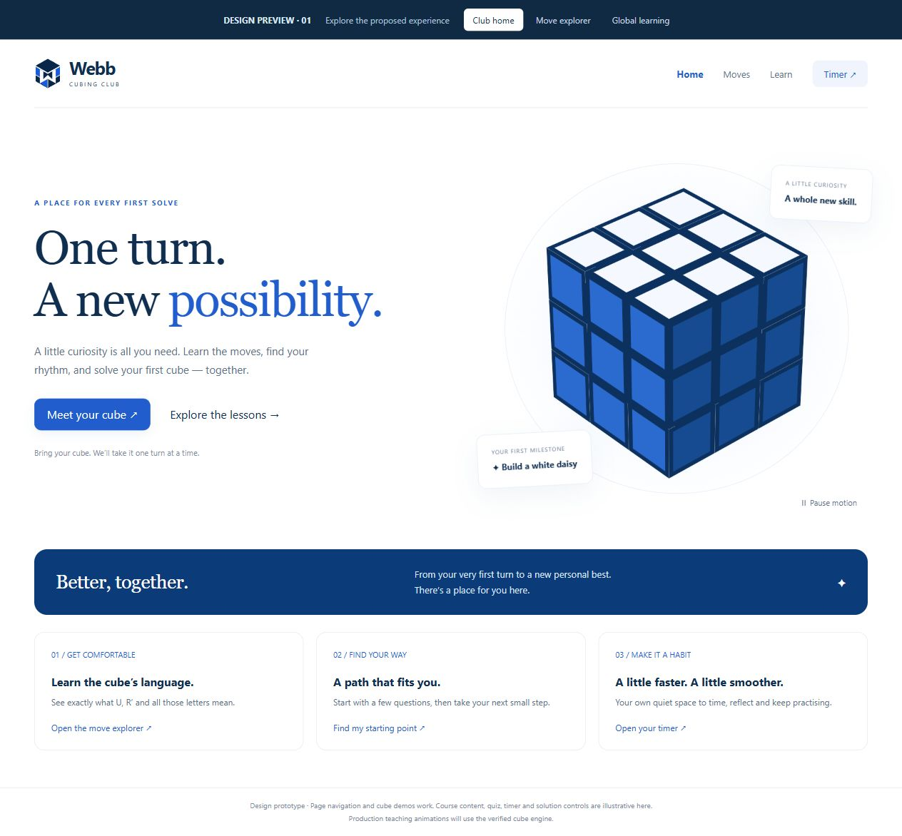
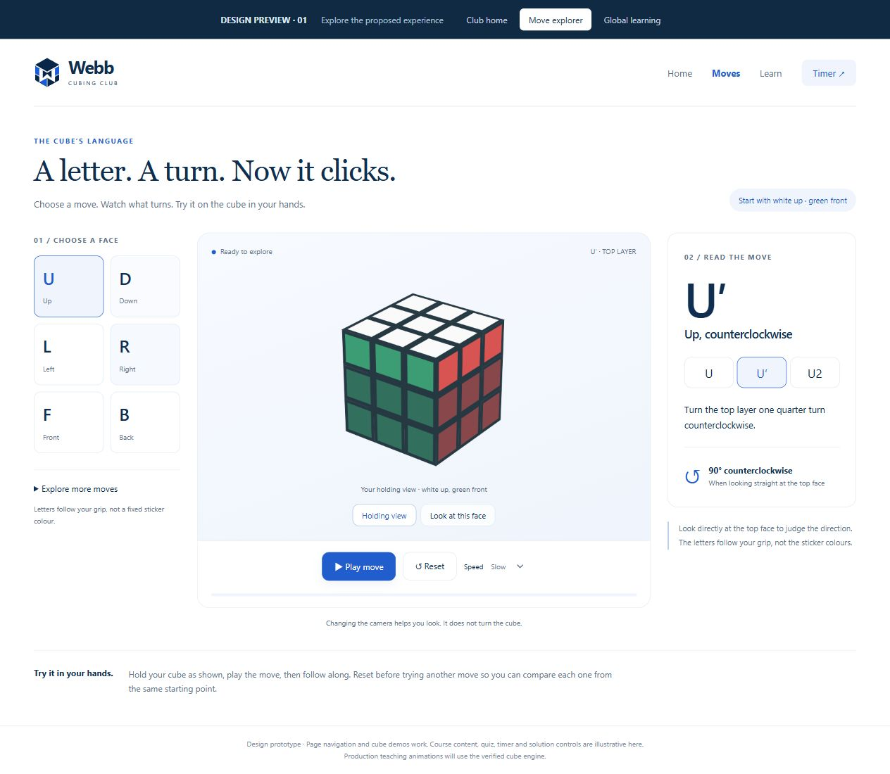
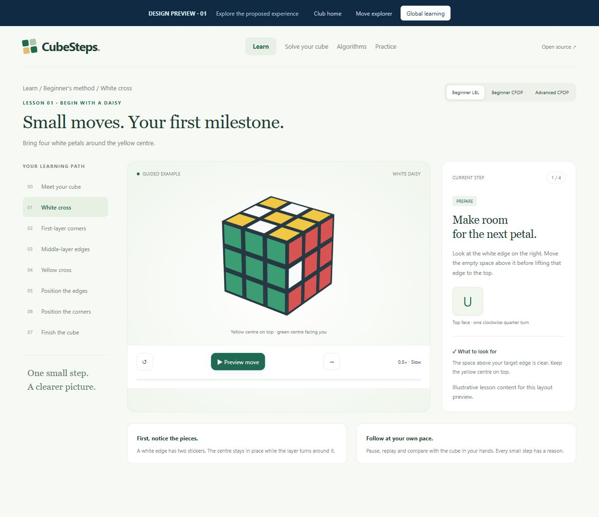

# CubeSteps UI Refresh and Club Move Explorer

Status: the owner approved the interactive visual direction on October 13, 2026. This written specification is awaiting review. Product implementation has not started.

## 1. Purpose and agreed scope

Make the club website more inviting and help its mostly beginner members translate cube notation into confident physical turns. Refresh global CubeSteps with the same attention to clarity while retaining its separate green-and-white identity. All product text remains English.

The owner approved these decisions:

- Replace the club homepage's disproportionate static illustration with a correctly proportioned blue-and-white cube. Give it gentle rocking and occasional layer turns, with a way to stop decorative motion.
- Add a dedicated club notation page. Show `U`, `D`, `L`, `R`, `F`, `B` and their prime/half-turn variants first. Put whole-cube rotations, wide turns and middle slices in an expandable advanced section.
- Use a move workbench: choose a symbol, see the moving layers, read its meaning, and play/replay a slow demonstration. Explain direction from the relevant face and distinguish camera movement from a physical regrip.
- Retain global CubeSteps' green-and-white palette and branding. Improve typography, cards, player/explanation layout, responsive navigation and restrained interaction feedback.

This design supplements the [club edition design](2026-10-12-webb-cubing-club-design.md). It supersedes that document's club navigation and homepage-decoration details where stated below. The existing questionnaire, timer, storage rules, discreet community link, public access model and school-name restrictions continue to apply.

The first outcome is a novice who can distinguish `U`, `U′` and `U2`, understand `D` and `B` without reversing the instruction, and recognize whether a symbol moves one layer, two layers, a slice or the entire cube. The visual outcome is a balanced homepage and a clearer teaching workspace on desktop and phones.

## 2. Approved visual references

The owner reviewed a three-screen interactive prototype. These files preserve that direction independently of a temporary localhost server:

- [Interactive prototype](assets/notation-ui-refresh/preview.html)
- [Club homepage](assets/notation-ui-refresh/club-home-desktop.jpg)
- [Move explorer, desktop](assets/notation-ui-refresh/notation-desktop.jpg)
- [Move explorer, phone](assets/notation-ui-refresh/notation-mobile.jpg)
- [Global learning, desktop](assets/notation-ui-refresh/global-desktop.jpg)
- [Global learning, phone](assets/notation-ui-refresh/global-mobile.jpg)

These establish composition, palette, density and the interaction concept. The prototype's custom teaching renderer, illustrative lesson state, sample text, incomplete navigation and simplified controls are not production implementations or verified teaching data. Do not import the prototype wholesale into the app. Preserve existing real content and controls when translating the layout. Essential text and controls may be larger than the screenshots to meet accessibility requirements.

Alternatives considered: a sequential notation wizard provides more onboarding structure but makes quick lookup slow; a grid of simultaneously animated move cards offers an overview but divides attention. The selected workbench supports both first learning and later reference, with one animation at a time.

## 3. Club homepage cube

### Geometry and appearance

Build the illustration from equal-sized cubies in a single three-dimensional coordinate system. Project all faces through the same camera. Equal physical edges must remain equal before projection; do not stretch independently drawn face grids to fill the container. Maintain square stickers, consistent gaps and continuous cube edges through each turn.

Retain the approved blue/white decoration, existing W-in-cube club logo, soft orbit, restrained shadow and two small supporting notes. Keep the cube inside its own responsive bounds; notes must not obscure it or cause horizontal scrolling. Decoration remains visually distinct from the six-color teaching cube.

Use a lightweight local vector/canvas projection component for this decorative illustration. It must not import the solver, algorithm registry or cubing.js rendering/search chunks into the homepage. The feature has only a predetermined decorative turn sequence; it is not a second general-purpose puzzle engine. Include a static vector fallback if drawing fails.

### Motion behavior

Use a roughly 12-second loop: rest, smoothly perform one upper-layer quarter turn, hold briefly, perform its inverse, and rest again. Keep sticker positions consistent through the sequence and return exactly to the assembled starting state. Add only small, slow changes of overall viewing angle; no full-speed spinning, flashing or scroll-linked motion.

An accessible Pause motion / Play motion control pauses this illustration within the current visit. It does not create another persisted preference. The existing club decorative-motion setting and system reduced-motion preference take priority. When either disables decoration, display the assembled static cube and a concise explanation rather than a Play control that falsely promises motion.

Stop the animation scheduler when the illustration is offscreen, the document is hidden, motion is disabled or the component unmounts. Resume smoothly without advancing through a backlog of hidden frames. Cap drawing resolution sensibly on high-density phones. Keep the decorative canvas outside the accessibility reading order; the pause control remains accessible.

Preserve the current primary Start/Resume learning behavior and questionnaire entrance. Add a prominent Move explorer card/entry as shown in the visual direction without silently replacing an existing resume action with the prototype's sample CTA. Retain access to the independent Timer.

## 4. Club Move Explorer

### Navigation and catalog

Add the club route `#/moves`. The primary navigation becomes Home, Moves, Learn, Timer, with a clear active state. Add a link from the club notation/holding lesson and the club learning tools. Existing `#/learn/notation` remains the course introduction; it is not redirected or removed. Feature links stay in the club shell. The new standalone explorer is club-only in this release.

Catalog:

| Group | Base symbols | Variants per symbol |
| --- | --- | --- |
| Six faces, visible by default | U, D, L, R, F, B | Plain, prime, 2 |
| Whole cube, advanced | x, y, z | Plain, prime, 2 |
| Two layers, advanced | Uw, Dw, Lw, Rw, Fw, Bw | Plain, prime, 2 |
| Middle slices, advanced | M, E, S | Plain, prime, 2 |

This gives 18 basic and 36 advanced demonstrations. Use explicit `w` spelling in controls; briefly explain lowercase wide-turn aliases without adding duplicate controls. Display a proper prime glyph `′`, with an accessible spoken label such as "U prime, top face counterclockwise"; use canonical ASCII notation internally. The free-scramble parser retains its existing outer-face input contract.

The first selection is `U`, with no autoplay. The visitor selects a face/move and plain/prime/half-turn amount. Preserve the amount and camera mode while changing the base symbol, but recompute the direction preset for the newly selected move. Each demonstration starts from the same solved cube with white up and green front. Resetting is explicit in the instructions so a member does not treat unrelated examples as a cumulative algorithm.

### Learning and direction

Show the selected token prominently, its English name, what moves, a one-sentence instruction and a direction cue. Identify the moving layer(s) using both a visual highlight and text. Dim stationary pieces without replacing genuine sticker colors or hiding essential orientation cues.

A plain face letter is a clockwise quarter turn viewed directly at that face; a prime reverses it and `2` denotes a half turn. Explain that a half turn has the same endpoint in either direction. Face letters describe the current physical hold, not a permanent color. The outer-face, wide-turn and rotation conventions follow [WCA Article 12](https://www.worldcubeassociation.org/regulations/#12a).

For advanced moves, explicitly state that wide turns move the named outer layer and its adjacent middle layer, `x/y/z` rotate the whole cube like `R/U/F`, and `M/E/S` move the middle slice like `L/D/F`. Slice moves move centers and are not whole-cube regrips. Keep the slice convention consistent with existing course text and the engine; do not describe slice notation as part of WCA's official outer-move list.

Provide two deliberate camera modes:

- **Holding view:** a stable three-quarter view of the reference grip. Dragging can inspect the cube; a reset-camera action restores the chosen preset.
- **Direction view:** for outer-face turns, look directly at the named face, with a clearly labeled clockwise/counterclockwise guide. `D` and `B` must be shown from outside their own faces, never as a mirrored projection through the front. For wide/slice moves, use an oblique view that keeps the moving layers visible, plus a labeled reference-side direction diagram; a head-on outer face must not hide the slice being taught. Whole-cube examples identify the reference side and label the action as a physical regrip.

Camera changes never append puzzle moves or alter the cube state. Clearly label them as observation only. Stop a running demonstration at its current position when changing camera mode, then let the member resume. Do not animate the camera and the turn at the same time. Reference-side direction arrows must not remain incorrectly attached to the screen after manual orbit; retain the labeled fixed reference diagram or restore the preset before presenting an on-cube arrow.

The start-grip caption is labeled as a starting instruction. After a whole-cube or slice move, any caption claiming the current top/front colors must derive from the engine's observed centers; never continue claiming that white is currently up when it has moved.

### Controls and state

Provide Play/Pause, Replay, Reset and Slow/Normal speed controls. A single selected move plays once, holds its final position and offers Replay. There is no default loop or automatic next move. Replay returns to the example's initial state and then plays; it is not shown as an additional inverse move for the member to follow. Reset stops playback and returns to the initial state while retaining the selected token, speed and camera preset.

Use one controller for selection, playback phase and progress. Its stable states are loading, ready, playing, paused, complete and error. The selected canonical move determines the explanation, highlight, demonstration and endpoint together. Changing the token cancels the old animation, resets progress and produces the new example atomically. Rapid selections, loading races and late renderer events cannot restore an older token or explanation. Play is enabled only once the displayed example and renderer agree.

Changing speed preserves progress without a jump. Leaving the route disposes the renderer and animation callbacks. Hiding the document or losing window focus pauses teaching playback; returning does not resume automatically. No audio, autoplay, persistence, scoring, arbitrary sequence editor or notation quiz is added.

## 5. Global CubeSteps UI refresh

Retain CubeSteps' name, mark, green/white palette and small warm accent. Use clearer headings, more consistent spacing, soft surfaces, restrained borders and a common button/card hierarchy. The existing default route remains the LBL introduction; this release does not add a separate global marketing homepage.

Apply the visual system to the existing Learn, Solve Your Cube, Algorithms and Practice pages, including method selection, six-face input, error/empty/loading states and formula details. Concentrate structural layout changes on the shared learning/solving workspace: secondary stage navigation, a prominent cube/player, and a nearby current-action explanation. Preserve usable formula browsing and practice controls while making their cards and typography consistent.

The current action panel shows its actual trace phase, selected move, recognition/preparation explanation and checkpoint. Keep full formulas, repetitions, target highlights, regrip instructions, playback controls, stage jumps and previous/next actions accessible. If the current action is observation or has no move, do not invent a move to fill the design's sample token. Render skipped stages and solved inputs truthfully.

Use a focused lesson header with method and stage context. Avoid repeated banners that push the cube and current instruction far down the page. Keep every accepted LBL, Beginner CFOP and Advanced CFOP route and the shared F2L follow-along behavior. The existing solve records and lesson content remain the authority; the visual prototype's daisy state and text are placeholders only.

Scope global CSS through the existing edition boundary or explicit presentation classes. Share useful components and tokens with club learning while retaining club blue/white branding and its accepted Timer layout. No new method, solver optimization, algorithm selection policy, account system, analytics or storage migration is part of this refresh. Global navigation does not promote the club URL.

## 6. Responsive behavior and accessibility

Desktop Move Explorer uses the approved three-part layout. On phones, use a compact face picker and selected token, place the plain/prime/2 choices next to the playback area, then the cube, controls and concise explanation. A learner should not have to repeatedly scroll between the suffix selector and Play. Keep advanced symbols behind a labeled disclosure; group rotations, wide turns and slices inside it.

Global learning on phones shows the current lesson in a collapsible lesson selector, then the cube/current instruction and controls in a coherent reading order. Expanding the selector exposes every lesson. It must not hide all other lessons permanently as the static prototype does. Avoid separate scrolling panes and fixed overlays that cover controls.

Verify widths of 360 px, 390 px, 768 px, 1024 px and a normal desktop viewport. Use readable instructional text, adequate contrast, visible keyboard focus and at least 44 px primary touch targets. Essential control labels and instructions must not depend on tiny decorative type. Selected controls expose their state semantically; color alone is insufficient. Every action works with keyboard and touch. Do not capture unmodified global letter/Space shortcuts on the explorer.

Decorative motion follows the edition's existing preference and the operating system. Essential user-requested teaching playback is separate from the decorative-motion preference. Under system reduced motion, offer static Before/After endpoints, clear direction diagrams and text instead of intermediate turn/camera animation. If the system switches to reduced motion during a turn, cancel playback and show the Before endpoint with a short status message; an already completed demonstration can retain After. Turning reduced motion off does not autoplay. Announce selected moves, load/error status and completion, not every animation frame.

## 7. Architecture, data flow and failure behavior

Continue the current React/TypeScript/Vite application, dual entry points, cubing.js dependency and browser-only deployment. The installed APIs/types and engine remain the implementation authority; consult [cubing.js documentation](https://js.cubing.net/cubing/alg/) as supporting reference rather than assuming a new dependency version.

| Unit | Responsibility and boundary |
| --- | --- |
| Decorative cube geometry/view | Equal-size geometry and one reversible branded animation; no solver or teaching-state authority |
| Notation catalog | Typed move families, canonical tokens, names, moving-layer descriptors, reference sides and explanation rules |
| Notation demonstration builder | Receives engine and selected token; returns solved initial state, one canonical teaching move and verified final state |
| Notation playback controller | Selection/version, readiness, clock/progress and user actions; independent of page styling |
| Notation renderer adapter | Uses cubing.js for the actual teaching move; manages camera/highlight/preset and renderer readiness/disposal |
| Club explorer page | Accessible responsive composition and club routing; no solver invocation or practice-history writes |
| Edition presentation styles | Global visual refresh and shared component refinements, scoped to preserve club identity |

Reuse existing `TeachingMove`, `CubeEngine.apply/observe`, facelet conversion, renderer readiness practices and clock/control conventions. A standalone notation demonstration is not a solve and not an OLL/PLL/F2L case: do not manufacture a successful `SolveTrace` or an algorithm-registry case ID. Keep its small data model explicit. Extract only the low-level rendering utilities that need sharing; preserve existing solve/algorithm player interfaces and initial-state behavior.

Data flow: catalog selection -> canonical token -> demonstration initial/final state -> renderer/controller -> synchronized visible instruction and highlight. Camera state is separate from puzzle state. Derive completion and fallback snapshots from the actual engine, including moving centers. Do not use hard-coded colored stickers as production teaching truth.

Lazy-load the new teaching page and its heavy dependencies on the Moves route. The club homepage/quiz stay lightweight. A loading failure offers a local Retry or reload instruction with usable navigation. If 3D is unavailable or rendering fails, retain the text and display engine-derived static Before/After diagrams with face labels; report the unavailable animation honestly. A mismatch between selected token and renderer readiness disables playback until it is resolved.

The page does not save move progress, change lesson completion or touch timer records. Existing motion preference storage behavior, including unavailable or unsupported storage, is preserved. Recovery must not claim an example played successfully when it did not.

## 8. Verification and acceptance

### Notation correctness and interaction

- Cover all 54 canonical demonstrations. Compare initial/final states and all 54 renderer stickers, including centers, to the engine. Use independent hand-checked facelet movement fixtures for representative axes and all families; do not rely only on applying a move and its inverse through the same implementation.
- Check plain/prime direction and half-turn endpoints, especially `D`, `B`, `M`, `E`, `S`, wide moves and `x/y/z`. Verify four quarter turns restore the reference state and a half turn equals two corresponding quarter turns.
- Inspect animations as well as endpoints: a prime must not take the plain move's direction, stationary layers must remain stationary, and arrows must agree with the selected reference side.
- Test selection during loading/playback, repeated Replay, pause/resume, reset, speed changes, focus/visibility interruption, route exit and late callbacks. Explanation/highlight/token must never lag behind the active demonstration.
- Verify camera changes leave the puzzle state untouched and that slice direction views expose the moving layer. Check actual regrip center changes and captions.
- Exercise keyboard/touch controls, advanced disclosure, static reduced-motion mode, unavailable WebGL and failed loading/retry.

### Visual and existing-feature regression

- Check homepage proportions at every viewport and during layer turns; confirm exact return to the assembled state, motion pause/offscreen/hidden behavior and absence of heavy teaching chunks on Home/quiz.
- Review the five responsive widths, no horizontal overflow, readable text, target sizes, focus states and a sensible phone reading order. Take screenshots for both editions.
- Exercise LBL daisy lessons, both CFOP routes, explicit F2L regrips, solved/skipped stages, six-face input, algorithm detail/practice, lesson resume and the independent timer. Verify the full formula and current-move/checkpoint information survives the redesign.
- Run relevant unit/controller/renderer/browser checks during development, then typecheck, build and existing required repository/CI regression suites before release. Do not weaken the fixed-seed solver corpus or its assertions for a UI change; repeat heavy tests only when code changes/failures justify it or the release workflow requires it.
- Test production base paths, worker/renderer assets, both entry points and direct `club/#/moves` refresh. Check deployed lazy modules and browser errors; an earlier preview inspection encountered a failed dynamic import, whose cause has not been established.
- Perform physical follow-along acceptance: a club novice can follow U, U-prime, U2, D and B; a CFOP learner can distinguish wide/slice moves from x/y/z and explain why changing the camera is not another algorithm step.

## 9. Implementation and release boundary

Implement in reviewable slices: decorative cube; catalog/controller/renderer and explorer; global presentation; integration/accessibility/regression. The written implementation plan must state concrete files, dependencies, meaningful tests and a final independent review. Continue to use the owner's previously selected Native execution method when the implementation plan is approved.

The current deliverable is this specification and the approved visual references. Written-spec approval permits the implementation-plan stage; it does not label the prototype or production feature complete. Publishing uses the existing repository and GitHub Pages artifact after implementation, verification and applicable release authorization. Verify public URLs and local/remote state before reporting a release.

Deferred: a global Move Explorer entry, cumulative notation sequences, notation quizzes/scoring, new solving methods, timer feature expansion, member accounts and additional personal data collection.
