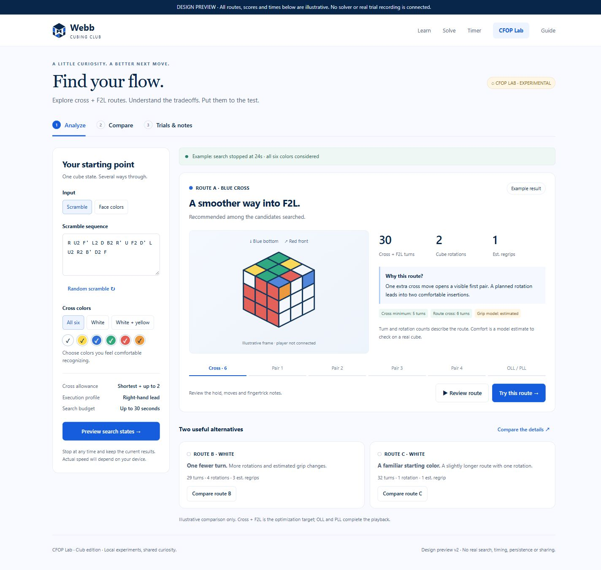

# CFOP Lab: Club Experimental Solver and Physical Comparisons

Status: conversational solver design and workspace/trial mockup approved by the owner on October 14, 2026. This complete written design is awaiting owner review. Product implementation has not started.

## 1. Purpose and confirmed decisions

Help club members investigate how cross choice, F2L order, visibility, fingertricks and physical rotations work together. The central experience is to explore a recommendation, understand its alternatives, and compare fixed routes on a real cube. The president and vice-president will help assess whether the execution model matches human experience.

CFOP Lab is a separate **Experimental** workspace in the club edition. The existing public-access model remains: members need no account, and the club URL is publicly accessible. Lab entry points appear only in the club edition. The accepted teaching methods and the global edition retain their current behavior.

Confirmed choices:

- Present one recommended route and two or three meaningfully different alternatives when available.
- Consider all six cross colors, while allowing users to restrict the allowed colors.
- Compute the exact minimum cross length for each allowed color. Consider cross routes up to **two moves longer than that color's own minimum**.
- Optimize cross and complete F2L together through a bounded search over recognizable maneuvers. Evaluate pair order, formula variants, holds, visibility and execution continuity.
- Produce a usable initial result, then improve it progressively within an approximately **15–30 second** search window. Users can stop and retain valid results.
- Start with a **right-hand-leading, two-handed** execution profile. Left-hand preference and personal calibration are later extensions.
- Allow useful physical rotations. Distinguish cube rotations, estimated hand regrips and camera movements.
- Continue route playback through existing OLL/PLL rules to a solved cube. The experimental optimization objective ends at F2L completion.
- Use three views: **Analyze**, **Compare**, and **Trials & notes**.
- Support local experiment records, in-page or manually entered timing, subjective feedback, and deliberate JSON/CSV transfer between devices.

The approved visual reference is [the workspace preview](assets/cfop-lab/preview.html). Its candidate metrics, cube illustration and trial results are illustrative. They are not solver fixtures or benchmark evidence.

## 2. Scope and claims

### First experimental release

The release includes six-color analysis, bounded cross/F2L search, a documented execution model, explained route playback, candidate comparison, and a local physical-trial notebook. It includes a short Lab introduction and an additional Guide section explaining counts, estimates, starting holds and the trial endpoint.

It does not include a new CFOP course, a 3D hand animation system, smart-cube integration, automatic detection of real hand movements, member accounts, cloud synchronization, leaderboards, or automatic updates of scoring weights from submitted trials. Existing guide films do not need to be recreated for this release.

### Evidence labels

| Label                             | Meaning                                                                                                                                                             |
| --------------------------------- | ------------------------------------------------------------------------------------------------------------------------------------------------------------------- |
| Exact cross minimum               | Minimum number of outer-face turns to match the four selected-color edges to their side centers, verified through the cross distance table and color/frame adapter. |
| Verified route                    | Every move and checkpoint has been replayed against the original physical cube state; the complete route solves the cube.                                           |
| Recommended among searched routes | Highest-ranked complete candidate found under the recorded model, limits and coverage. This is not a global F2L optimum.                                            |
| Execution estimate                | An estimate from the documented grip/visibility model, not measured human speed or an observed regrip count.                                                        |
| Physical trial                    | User-recorded timing and feedback under the displayed conditions; route adherence and completion are self-reported.                                                 |

Do not claim universally fastest F2L, a guaranteed fastest complete solve, or research novelty. Present CFOP Lab as a reproducible experiment that can test and improve its own recommendations.

## 3. Architecture and compatibility

Use the existing React, TypeScript, Vite, cube engine, notation handling, player primitives and algorithm catalog. Keep all computation in the browser, with the new search in a dedicated, lazily loaded worker. No service or third-party inference API is required.

Keep these boundaries small and explicit:

| Module                      | Responsibility                                                                                                           |
| --------------------------- | ------------------------------------------------------------------------------------------------------------------------ |
| Lab input/frame adapter     | Validated input snapshot, allowed colors, actual/virtual frame mappings, physical piece identities and repeatable setup. |
| Cross explorer              | Exact per-color distance and bounded enumeration of shortest and near-shortest cross candidates.                         |
| F2L planner                 | Formula-based continuation through all remaining pairs, retaining relevant alternative states and holds.                 |
| Execution model             | Feasible symbolic grip paths, visibility events, continuity costs and human-readable rationale.                          |
| Lab validator/trace adapter | Physical replay, stage and score verification, player-compatible presentation and archive validation.                    |
| Search coordinator          | Deterministic scheduling, work/time limits, progress, incumbent results and cancellation.                                |
| Club Lab UI                 | Analyze, comparison selection, pinned playback and entry to physical trials.                                             |
| Experiment repository       | Immutable experiment snapshots, editable trial records, descriptive summaries, import/export and storage recovery.       |

Suggested source homes are `src/lab/` for the engine-independent Lab domain, `src/workers/lab.*` for its protocol/worker, and `src/club/lab/` for the club workspace. These names describe responsibility, not mandatory implementation file counts.

Current `SolveTrace` and the Advanced runtime assume a white bottom, named Advanced stages and distance-decreasing cross actions. A Lab route needs its own discriminated contract and validator. Do not disguise a near-shortest cross as an existing `shortest-cross` action or weaken the current Advanced validator. Adapt a validated Lab route to shared player primitives through a presentation boundary. Any shared type widening must preserve the existing methods' discriminants and checks.

Existing solver endpoints remain single-result APIs. Lab has a separate streaming protocol. The club entry lazily loads its UI/search assets; opening the global home, ordinary club pages or the Timer must not initialize the Lab worker or execution catalog.

## 4. Input, colors and physical frames

Accept the existing random/text scramble flow and six-face color editor, including their legality checks and draft handling. The text scramble grammar remains the current outer-face notation. Preserve the supplied center-color scheme and immutable physical corner/edge identities.

Allowed-color controls offer All six, White, White + yellow, and individual color selection. At least one color must be selected. All six is the initial Lab default. Store this preference locally.

For each bottom color, consider the four adjacent front colors. A reversible orientation/color-scheme adapter maps this physical problem to the canonical coordinates expected by existing recognition rules. The adapter must transform piece identities and orientations consistently; changing color strings in explanations is insufficient.

Normalization is a computational representation change. It neither changes the physical state nor adds an invisible move. Map every selected move, target, diagram, algorithm reference and checkpoint back to the real cube. Produce explanations from physical before/after observations and semantic templates rather than replacing the word “white” in existing prose. Pure hand-regrip events annotate move boundaries; they must not become fake cube-rotation tokens or change the engine state.

Every route declares:

- The original input state and input hold.
- A bottom/front starting hold, with explicit positioning instructions from the input hold.
- A neutral initial hand-grip profile.
- All actual rotations during execution and the resulting bottom/front labels.

Initial positioning is shown separately and occurs before a measured trial. It is excluded from the cross/F2L execution score and timed duration. Every physical rotation after the trial starts is included. Camera movement changes neither the state nor the move sequence.

For repeated trials, scramble inputs retain their original sequence and six-face check diagram. Color inputs receive a setup sequence reconstructed from a verified complete solution, normalized to the documented solved starting hold. Replay the setup from solved and compare the full state and centers to the input before offering it. Setup playback may explicitly use supported wide/slice/rotation notation if needed; it must not be presented as an accepted text-scramble string unless it meets that grammar.

## 5. Joint search

### 5.1 Exact cross reference and candidates

Reuse the integrity-checked 190,080-state cross distance table through the tested color/frame adapter. The minimum is independent of the chosen front hold under the outer-face-turn metric. Compute and retain a reference minimum for every allowed bottom color.

Explore outer-face sequences at lengths `d`, `d + 1` and `d + 2`, where `d` is that bottom color's minimum. Use the table as a remaining-distance lower bound. A near-shortest path may temporarily increase distance; validate its final cross and total allowance rather than requiring every step to descend.

Deduplicate identical move paths and safely redundant representations, but do not collapse paths merely because their four cross edges share a coordinate. Their remaining pieces, grip transitions or last moves may differ and affect F2L. When a search state is merged, its identity must include the full relevant cube state, hold and execution-model state.

Track any pairs solved at the cross checkpoint. Such a route may be described as an X-cross opportunity. The first release discovers these opportunities inside the admitted cross allowance; it does not promise exhaustive X-cross or multi-pair block search.

### 5.2 F2L continuation

For each crossed candidate, enumerate legal preparation/insertion maneuvers for each remaining pair using the admitted algorithm catalog. Include existing handling for trapped pieces, wrong slots, already-completed pairs and deliberate changes of hold.

Each completed pair maneuver must preserve the cross and previously completed pairs at its checkpoint and solve at least one previously unsolved pair. Temporary disturbance within an admitted maneuver is allowed and explained. This gives a maximum of four progress steps after the cross; no search branch may cycle through completed-pair checkpoints.

Use a bounded beam of alternatives through **all remaining pairs**, rather than selecting the next pair irreversibly after only one-step lookahead. Retain diversity in resulting state, front hold, solved-pair mask and terminal grip state. Keep formula boundaries, repetition metadata and preparation explanations in every branch.

The shared catalog remains the source of move definitions. Extend it with an execution variant only after verifying its case, physical effect, grip profile, explanation and provenance. Do not admit arbitrary search strings as named teaching formulas.

### 5.3 Execution model and ranking

Version the initial policy as `lab-execution-v1`. It is a documented engineering hypothesis to evaluate, not a fitted timing predictor.

Use a finite symbolic grip-transition graph. Cross turns and formula segments have admitted execution profiles containing allowed entry/exit grip states, active hand/finger or wrist action, hand repositioning events and short instructions. A small dynamic program carries feasible grip states across adjacent segments, retaining the lowest modeled cost for each terminal state. Cube rotations update both physical holding frame and grip state; pure hand regrips leave the cube state unchanged.

This is more expressive than adding a fixed penalty to each isolated formula: two formulas can have a cheap individual profile but an awkward transition between them. Disallow impossible transitions. A candidate without sufficient execution coverage may appear as a verified, unrated reference, but may not receive a comfort recommendation or an invented regrip estimate.

Initial scalar score, in **model cost units**:

`cost = T + 2R + 2G + 3V + 2A`

| Term | Definition                                                                                                                                                                 |
| ---- | -------------------------------------------------------------------------------------------------------------------------------------------------------------------------- |
| `T`  | Cross + F2L turn equivalents. Outer-face and wide turns cost one; middle-slice turns cost two. Half turns retain those costs.                                              |
| `R`  | Explicit physical cube rotation tokens during execution; a half rotation is one token.                                                                                     |
| `G`  | Estimated pure hand-reposition events along the selected admitted grip path. A rotation's required handling is charged under `R`, not counted again as the same `G` event. |
| `V`  | Recognition checkpoints where the identifying stickers fall outside the declared front-view envelope and an additional view change is predicted.                           |
| `A`  | Awkward but feasible transition events explicitly marked by the execution catalog, excluding events already charged as a regrip or view change.                            |

These weights are initial design defaults, not empirical measurements. Keep the terms and events available for inspection. Do not label the cost as seconds, a percentage of human efficiency, or a probability of success. Useful rotations can lower the total by improving recognition or avoiding awkward grip transitions.

Resolve equal costs deterministically by `T`, `R`, `G`, then a stable route key. Color familiarity is controlled by the allowed-color set and shown as a tradeoff; the initial policy must not infer an unprovided skill profile. The Lab does not silently change its weights based on a small number of trials. Future recalibration creates a new policy version with a documented benchmark comparison.

### 5.4 Progressive scheduling and limits

First produce a fully verified complete route for an allowed color using a shortest-cross seed and a bounded catalog continuation. Then cycle across allowed colors/front holds and progressively expand near-shortest crosses and F2L alternatives. A seed outside the user's allowed colors cannot be substituted silently.

Starting configuration for the implementation plan:

| Limit                                                    | Initial value                                                                                                         |
| -------------------------------------------------------- | --------------------------------------------------------------------------------------------------------------------- |
| Wall-clock search budget                                 | 30 seconds, user-stoppable; results are intended to become useful earlier.                                            |
| Global search-work budget                                | 2,000,000 accounted expansions/simulation operations, including cache-hit work at the documented accounting boundary. |
| Cross completions retained per bottom color              | Up to 96, distributed across front holds and cross lengths.                                                           |
| F2L beam width per crossed root and completed-pair depth | Up to 32.                                                                                                             |
| Insertion/preparation candidates per target expansion    | Up to 12 after deterministic, diversity-aware pruning.                                                                |
| Shared cached states/frontier entries                    | Up to 25,000; eviction and pruning are deterministic.                                                                 |
| Complete route size                                      | Up to 512 teaching-move tokens and 128 actions.                                                                       |

The global budget covers all roots, holds, lookahead and execution scoring; it must not reset for every pair. Existing preparation limits may be tightened by the Lab, never bypass the shared budget. Numerical tuning within these ceilings is an implementation choice recorded in the configuration version. Expanding a ceiling or relaxing validation requires an explicit design revision.

The wall-clock deadline starts when Analyze is requested and includes lazy initialization; the UI distinguishes initialization from active search. A main-thread watchdog remains effective if worker initialization stalls. Yield to the worker event loop in bounded batches, targeting at most 8 ms or 256 expansions per batch, whichever arrives first. Check deadlines at those boundaries. Report elapsed time, verified candidate count, colors actually explored, limit reason and work count. Do not show a fictitious percentage of the full solution space.

Keep validated incumbents in the UI as they arrive. User cancellation can terminate the worker; it must not erase already-delivered routes. A new request or route exit cancels old work and ignores stale messages by request ID. A selected/playing route is pinned; newly discovered recommendations are offered without replacing its move position.

At a limit or error, report the actual reason. If valid results exist, preserve them with their coverage. If none exist, show an incomplete search with retry/restrict-colors options; do not label it an invalid cube or fabricate a successful result.

## 6. Route validation and presentation

Every published candidate must pass physical replay from the original input, matched-cross validation, completed-pair invariants, full F2L validation, OLL/PLL preservation, final alignment and solved-state validation. Map all actions back to actual colors and immutable pieces before this check. The main thread checks the message schema/request identity and independently replays the bounded finalists before enabling playback or saving an experiment.

The candidate snapshot includes raw moves, formula/variant references, move groups, checkpoints, starting and ending holds, initial grip, count breakdowns and execution events. Derive visible counts and evidence from these records. Any invalid candidate is rejected with a diagnostic; it cannot outrank a verified incumbent.

Extend existing player controls to the Lab presentation contract: play/pause, previous/next move, stage jump, formula replay, speed control, target highlighting and camera freedom. Grip notes appear at meaningful segment boundaries. Actual rotations remain visible move tokens, including backward stepping through a rotation.

Use distinct labels for “Cross minimum,” “This cross,” “Cross + F2L turns,” “Cube rotations,” and “Estimated regrips.” Put initial positioning and OLL/PLL counts outside the optimized subtotal. A fully solved or partially solved input may skip stages with an explanation; empty stages do not create phantom actions, times or practice requirements.

Select alternatives from validated complete routes. Start with the best modeled cost, then prefer non-dominated candidates illustrating fewer turns, fewer physical rotations, or a distinct allowed starting color/hold. Deduplicate identical routes and avoid filling slots with cosmetic rephrasings. Display fewer alternatives when fewer distinct verified routes are available, with a plain explanation.

## 7. Club interface

Routes are `#/lab` (Analyze), `#/lab/compare`, and `#/lab/trials`. A lightweight Lab workspace store preserves the current input, result selection and pinned routes when navigating among them. Persist only preferences and explicitly saved experiments; transient worker state is not restored as a running search after reload.

### Analyze

Use the accepted blue/white club visual language. Desktop places compact input controls beside the route player and recommendation; phones stack them. Offer random/text/color input, allowed colors, the fixed execution profile and a clear Analyze/Stop action. Use an accessible status region for significant progress, without announcing every expansion.

The recommendation explains its main tradeoff in plain English. Show current hold, player, key metrics, evidence labels and a Try this route action. Put the alternatives below with a Compare action. Familiarity controls constrain search without adding a second permanent solver mode to the normal teaching UI.

### Compare

Display bottom color, minimum/chosen cross length, F2L and combined turns, actual rotations, estimated regrips, recognition/transition rationale and a concrete point to check on a real cube. Keep rows aligned on desktop and contain horizontal comparison scrolling on narrow screens. Numbers must have text labels; color alone never identifies a route.

Let users pin two routes and save a comparison snapshot. Use stable route identifiers A/B within that comparison; later sorting must not silently swap their identities. A third alternative can start another pairwise comparison using the same experiment input.

### Trials & notes

Show the saved input, selected route, actual starting hold, setup sequence/check diagram and explicit Cross + F2L endpoint. Place the timer and brief feedback together, with the comparison routine and notebook nearby. On mobile, keep the active trial controls before the explanatory material.

Provide a first-use Lab introduction and Guide entry for the workflow and evidence labels. Tutorials must not intercept input during an active trial. Honor reduced motion, keyboard navigation, visible focus, touch target sizes and the club's existing accessibility patterns.

## 8. Physical-trial protocol

The first release measures **practiced route execution**. Let the user inspect and rehearse each route, then explicitly classify attempts as familiarization or measured. Unlimited preparation happens before the timer; there is no competition inspection penalty or automatic +2 rule in this workflow.

1. Reset to the saved starting state and verify the six-face diagram.
2. Adopt the selected route's starting hold and initial grip. Confirm readiness with an initially unchecked control.
3. Start timing using the established hold/release keyboard or touch interaction. Manual entry from an external timer is also available.
4. Execute the selected cross/F2L route. Stop timing once all four F2L pairs are solved, before OLL.
5. Record outcome and optional flow/recognition feedback. Reset before trying the other route.

Timing includes the user's start/stop interaction. Keyboard, touch and external/manual timing are distinct methods; compare like with like. The application does not sense cube turns or establish the actual first-turn instant. Route adherence and endpoint completion are self-reported.

Measured comparison blocks use A–B, then B–A order, repeated as desired. The app suggests the next route but never prevents an exploratory attempt. Store the intended and actual order, block identity and retry history. If an attempt is incomplete or deviates, keep it; a valid retry is a separate record.

When timing starts, pause route playback and background search. Keep setup instructions accessible before starting. Only the active timer consumes its start/stop keys; typing notes or using a selector must not start a trial. Blur, hidden tabs, navigation, Escape and cancelled touch input produce an interrupted record for review, not a normal valid time. Reconfirm setup before another attempt.

Feedback fields:

- Optional local tester label, backed by a stable local tester ID; names are not required.
- Attempt kind: familiarization or measured.
- Outcome: followed the route, deviated from the route, incomplete, or interrupted.
- Duration and timing method, with a visible manual-entry marker where applicable.
- Optional execution flow and recognition ease ratings, each 1–5 with labeled endpoints.
- Optional note about a particular pause, hold change or awkward segment.

Display raw attempts immediately. For a descriptive A/B summary, require at least **five complete matched A/B blocks**, hence at least five eligible attempts per route, for the same tester, experiment input, exact routes and timing method. This is a product display threshold, not a claim of statistical significance.

An eligible block contains measured, non-deleted, followed-route, uninterrupted attempts at the same endpoint. For a retry, retain the originally invalid record and use the first later eligible attempt explicitly linked to that block's open slot. Unpaired exploratory trials remain visible but are not silently added to the matched summary.

Summarize counts, median time for each route and the median paired difference `time(B) - time(A)`, with the sign explained. Show rating counts and distributions separately. Never impute missing ratings. Keep warm-ups, deviations, interruptions and unmatched attempts visible with their exclusion reasons. Do not pool different testers or inputs, call the display a scientific winner, or reuse ordinary Timer ao5/ao12 labels.

## 9. Data, storage and transfer

Use a separate IndexedDB database, `cubesteps.club.lab`, with schema version 1. Reuse proven repository patterns for pending writes, conflicts and retry, while keeping the ordinary Timer database unchanged. Preferences can use a namespaced localStorage key with schema validation.

### Experiment snapshot

An immutable experiment stores its ID, schema version, creation time, app/search/model/catalog versions, canonical state fingerprint, original input, center scheme, setup sequence, allowed colors and search settings. It also stores actual search coverage/stop reason, chosen route snapshots, physical move groups/checkpoints, initial holds/grips, metrics and referenced formula definitions sufficient for archival playback.

A comparison identifies exactly two saved route snapshots and assigns its stable A/B labels. A new search or changed route creates a new experiment/comparison instead of overwriting a previous trial's basis. Use stable fingerprints over canonical structured data; fingerprints establish identity and integrity, not who performed a trial.

### Attempt record

An attempt stores its ID, comparison/route/tester IDs, block and order metadata, retry linkage, kind, timing method, duration, outcome, interruption reason, optional ratings/note, timestamps and revision. Eligible measured attempts require a positive finite duration; an untimed warm-up or interruption before timing may have no duration. An attempt never embeds an unrecorded “current recommendation.” Corrections create a new revision; soft deletion and undo update the visible summaries predictably. Preserve a local revision trail for inspection.

A failed save remains clearly marked as unsaved in memory, with retry and export available. Do not claim persistence until the IndexedDB transaction commits. Unsupported/corrupt stored data is protected from automatic replacement; offer export and an explicit recovery action. Multi-tab revision conflicts request reconciliation rather than silently losing edits.

### Export/import

- **Experiment JSON:** input, fixed routes, versions and comparison data. Default to routes-only export; including tester labels and trial records is a deliberate option.
- **Results CSV:** flattened trial rows with identifiers, conditions, raw durations, outcome, ratings, order, revision and summary eligibility. Quote fields correctly and neutralize spreadsheet formula prefixes in user-supplied labels/notes.
- **Import experiment:** validate into a temporary in-memory workspace, show a summary, then commit a valid import transaction atomically. A partner can add trials on another device and export those records for return import.

Initial import limits: 10 MiB JSON, up to 50 experiments and 5,000 attempts per file, at most four route snapshots and six pairwise comparisons per experiment, 512 move tokens/128 actions per route, 60 characters per label and 2,000 per note. Formula snapshots must be referenced by the bounded route actions; reject surplus unreferenced definitions. Validate duration eligibility, integer ratings 1–5, recognized notation, state legality, referential integrity and bounded collection sizes before replay. Imported text remains plain text; files contain no executable callbacks, arbitrary remote resources or code. If an export would exceed these limits, request a smaller experiment/result selection rather than silently truncating records.

Deduplicate identical stable IDs/content. For the same ID with different revisions/content, preserve the stored record and offer explicit resolution or import as a separate copy. Unknown schema versions are rejected without altering stored data. For a recognized schema with an older/unknown model/catalog, validate raw moves physically and mark it archived; do not relabel its estimate as the current policy. If required definitions are absent or replay fails, reject that route and report why.

Imports never adjust scoring weights or transmit information. There is no automatic synchronization or message to another club member. Manual file transfer remains under the user's control.

## 10. Verification and release criteria

### Mathematical and trace correctness

- Revalidate the existing complete cross table and its asset integrity. Test color/frame mapping, inverse mapping and move conjugation for all 24 proper physical holds and all six selected bottom colors.
- Use independent physical-engine replay to verify every returned minimum-cross seed, near-shortest route, prepared setup and final solution. Test same-cross-coordinate states with different F2L consequences so deduplication cannot erase meaningful candidates.
- Cover solved input, an already-made cross, pairs solved during the cross, partially complete F2L, wrong-slot extraction, temporary disturbance inside a formula, non-descending near-shortest cross steps and a rejected `d + 3` route.
- Cover the 41 F2L classes in four slots/four horizontal holds across six bottom colors, plus admitted variants, 57 OLL/21 PLL cases and their skips. Validate actual colors, identifiers and checkpoint explanations.
- Replay at least 1,000 fixed-seed scrambles in deterministic work-budget mode, verifying shortest seeds for every allowed bottom color and every emitted finalist, including equivalent six-face inputs. This corpus need not run a full 30-second search for every case.
- Include forged metadata, wrong metric totals, unknown profile transitions and incorrect checkpoints. An invalid candidate must fail before playback/save.

### Search and execution behavior

- Verify color/hold scheduling, global budget accounting, deterministic work-budget output, bounds, cancellation, late messages and preservation of verified incumbents after failure or stop.
- Test grip compatibility across formula boundaries, useful rotations, unnecessary rotations, recognition visibility, distinct hand regrips, ties and preservation of alternative terminal grip states.
- Maintain reviewed fingertrick fixtures describing the expected physical handling. Correct cube algebra alone does not validate a fingertrick profile.
- Compare the same fixed corpus against the current Advanced solver using both white-only and all-six Lab settings. Report turn, rotation, model-cost, coverage and runtime distributions separately. Model-score improvement is internal evidence; it is not proof of a faster human solve.

### UI, storage and accessibility

- Verify input legality/error positions, progressive statuses, pinned playback, backward steps across rotations, comparison identity, route/setup holds and Guide entry points.
- Verify timing input focus, hidden/blur interruptions, setup confirmation, manual entry, endpoint labels, all trial classifications, retry matching, five-block threshold and missing ratings.
- Test failed saves, export of unsaved attempts, reload, version conflicts, corrupt/unknown data, duplicate/conflicting imports, archive playback, import limits and CSV escaping.
- Check desktop and phone layouts, contained table scrolling, keyboard-only use, screen-reader labels/status announcements and reduced motion in Chromium and WebKit.
- Run required type checks, unit/corpus/browser checks, production build and browser-console checks. Confirm ordinary solvers, the global edition, Guide and everyday Timer keep their accepted behavior and do not eagerly load Lab assets.

### Performance and physical acceptance

Measure first usable result separately from total search time. Initial targets are first-result p95 at most 5 seconds on the documented desktop and 8 seconds on a representative phone, with a responsive interface throughout. Stop should make current results usable within 250 ms; the 30-second worker deadline has a 500 ms watchdog margin. Record actual hardware, browser, cold/warm conditions, memory behavior and coverage. These are release targets, not results already achieved.

If targets cannot be met within the proposed limits, tune or narrow the implementation and report the measured tradeoff before release. Do not silently claim comprehensive six-color coverage or human-optimal output to compensate for a small search.

Before presenting the execution model as physically reviewed, the club president and vice-president should follow fixtures covering a useful rotation, a shortest-versus-near-shortest cross tradeoff, cross-to-first-pair continuity, a rear insertion, wrong-slot extraction, a non-white bottom and a color-input setup. Capture feedback on actual holds, finger instructions and trial flow. Keep the feature Experimental even after that acceptance; physical trials inform future model revisions rather than establishing universal optimality.

## 11. Delivery sequence and design artifacts

The implementation plan should separate three dependent work packages:

1. **Search and execution core:** color/frame adapter, exact references, bounded joint search, grip profiles, physical validator and performance/corpus evidence.
2. **Club workspace:** Analyze/Compare, progressive worker client, player integration, approved responsive layout and Guide content.
3. **Physical experiments:** trial input, fixed snapshots, local repository, summaries, transfer and complete regression/review evidence.

Validate search correctness and an initial device benchmark before committing to the complete UI integration. Preserve the stable teaching methods throughout. Implementation, independent final review, publication and physical acceptance are distinct milestones; this document authorizes none of them until its applicable review stage is complete.

Approved visual references:

- [Interactive layout reference](assets/cfop-lab/preview.html)
- [Analyze desktop](assets/cfop-lab/analyze-desktop.jpg)
- [Compare desktop](assets/cfop-lab/compare-desktop.jpg)
- [Trials desktop](assets/cfop-lab/trials-desktop.jpg)
- [Trials phone](assets/cfop-lab/trials-phone.jpg)

## 12. References and provenance

- [Existing Advanced CFOP design](2026-10-12-advanced-cfop-design.md): exact white-cross baseline, formula catalog and current method contracts.
- [Existing human-friendly F2L design](2026-10-12-f2l-human-friendly-design.md): visibility and deliberate physical holds.
- [Existing F2L validation report](../../validation/f2l-human-friendly.md): current heuristic measurements and the distinction between automated correctness and human comfort.
- [Boyce and Storm, “Rubik's cube: What separates the fastest solvers from the rest?” (2022)](https://emerginginvestigators.org/articles/21-189): observational evidence relating pauses, rotations/regrips and other factors to solve times. It does not validate this Lab model or its weights.
- [or18's cross/X-cross/F2L solver](https://github.com/or18/Rubiks-cube-xcross-solver): an existing implementation useful as a search reference and benchmark candidate. This design does not imply that its code has been adopted.
- [CubeDB](https://www.cubedb.net/): an existing solve-analysis tool providing context for the product space, not evidence of novelty.

Preserve source attribution and dependency licenses for any later reuse. The project authors its own UI, explanations and execution profiles; no external article, algorithm database or code is copied merely by citing it here.
